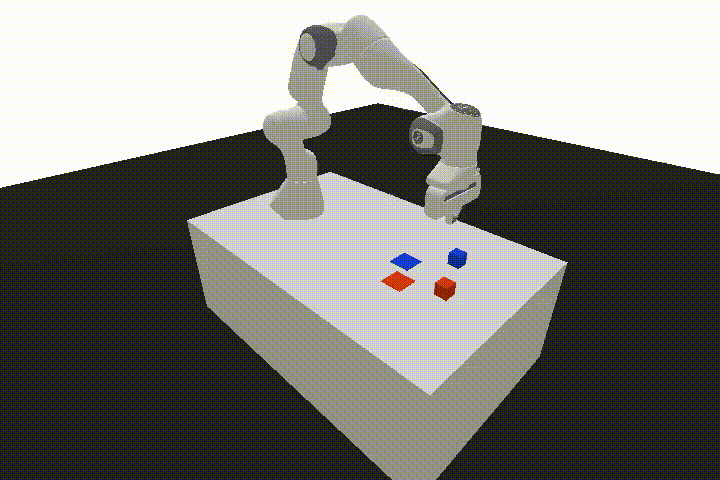
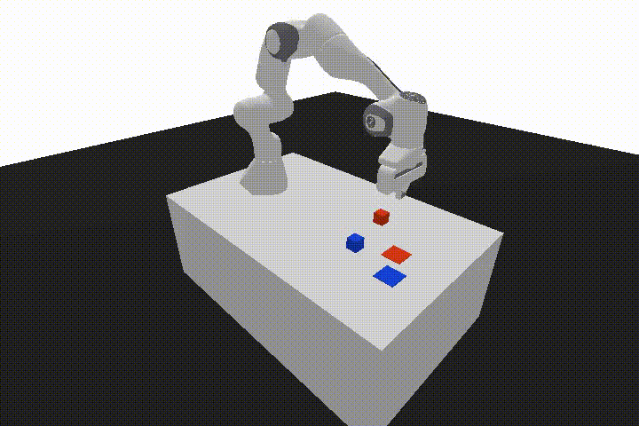
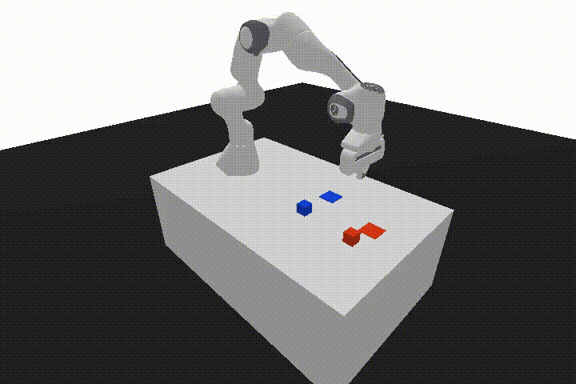
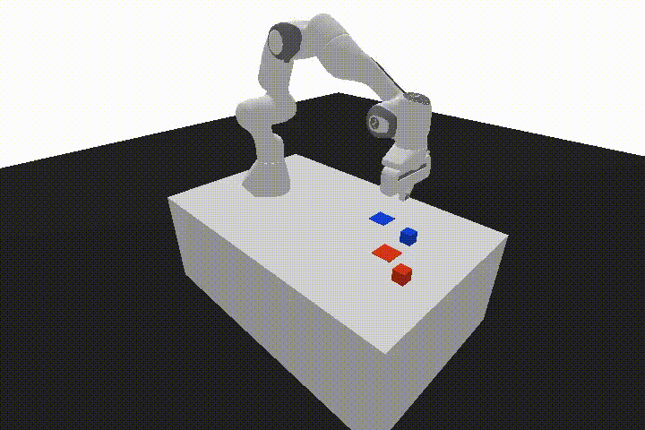
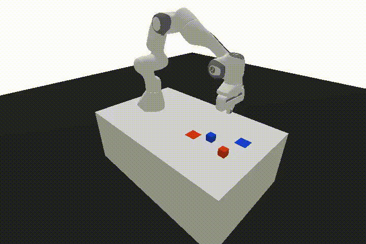
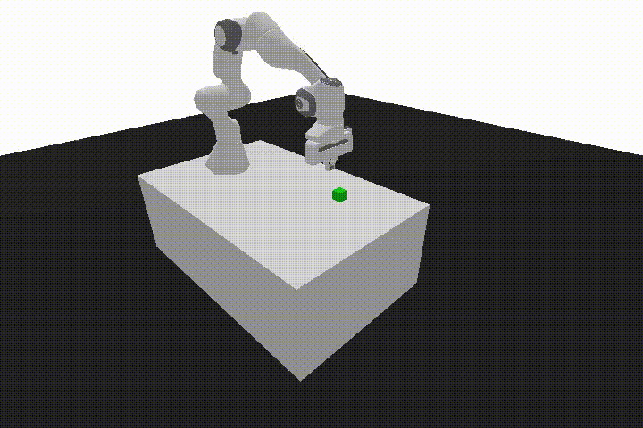

# Legible Motion via Reinforcement Learning

A research benchmark for studying legible robot motion in multi-object, multi-destination pick-and-place tasks. The environment is built on PandaGym and uses a Franka Panda robot simulated in PyBullet.

## Environment

### Task

The robot must pick a selected object and move it to a selected destination. Multiple objects and destinations are present simultaneously, with the selected object and destination sampled at reset.

The default configuration uses:
- 2 objects and 2 destinations.
- A Franka Panda robot with end-effector control.
- Randomized object and destination positions.

### Observation Space

The environment uses a goal-conditioned observation:
- `observation`: Panda robot observation with no task-specific features.
- `achieved_goal`: 3D position of the selected object.
- `desired_goal`: 3D position of the selected destination.

Other objects and destinations remain visible in the simulation but are not explicitly included in the task observation.
An initial approach to making them explicit in the observation was to include all object positions and a one-hot selected object indicator, but it turned out this approach hurts the learning.

### Action Space

A 4-dimensional normalized continuous action:
- 3 dimensions for end-effector Cartesian displacement.
- 1 dimension for gripper control.

### Rewards

Two reward modes are supported:
- **Dense:** negative Euclidean distance between the selected object's position and the destination.
- **Sparse:** 0 when the distance is below the success threshold, otherwise -1.

The active success condition is distance-based. A stricter physical-placement check (object inside destination, supported by the table, released, and stationary) is also implemented but is not currently used for termination.

## Demonstrations

FSM-generated episodes illustrating the multi-object environment:

<table>
  <tr>
    <td width="50%" align="center">
      
    </td>
    <td width="50%" align="center">
      
    </td>
  </tr>
</table>

## Preliminary Findings

### Episode Horizon

The standard TQC+HER baseline uses a 60-step episode horizon. A 50-step horizon frequently resulted in time-limit truncation which suggests that 50 steps may be insufficient for some trajectories; but the optimal horizon has not yet been established.

### Observation Space

The current policy receives robot observations and the selected object/destination goals, without explicit positions for the other objects and destinations.

Earlier experiments used an observation containing all object positions and a one-hot selected-object indicator. For some reasons not yet estabilished, this observation semantics 
caused a *runaway* effect in which the policy learned to always move far away from both objects and destinations, resulting in a low success rate.

<table>
  <tr>
    <td width="50%" align="center">
      
    </td>
    <td width="50%" align="center">
      
    </td>
  </tr>
</table>

The current observation semantics appears to be more stable.

### TQC + HER Baseline

The current standard TQC+HER experiment reached approximately **90% success with mean reward -3.639 +/- 9.134  after ~600k steps**.

For comparison, the default PandaGym PickAndPlace baseline reached approximately **30% success with mean reward -37.540 +/- 19.862 after 1M steps** in a separate experiment. The reason for this difference is not yet established.

<table>
  <tr>
    <td width="50%" align="center">
      
       
      <b>TQC-HER in Multi-Object Environment (~600k steps)</b>
    </td>
    <td width="50%" align="center">
      
       
      <b>TQC-HER in panda-gym pick-and-place-v3 (~1M steps)</b>
    </td>
  </tr>
</table>

## Current Baseline Configuration

- Algorithm: TQC
- Replay buffer: HER (`future`, 4 sampled goals)
- Reward: Dense
- Episode horizon: 60 steps
- Network: `[512, 512, 512]`
- Batch size: 2048
- Learning rate: `1e-3`
- Seed: 42
- Training: 500k steps
- Exploration: Standard policy exploration; no FSM assistance